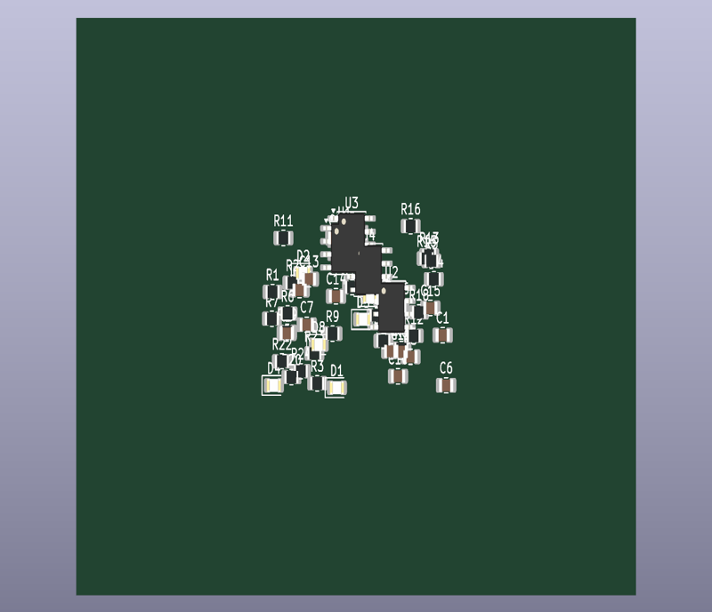
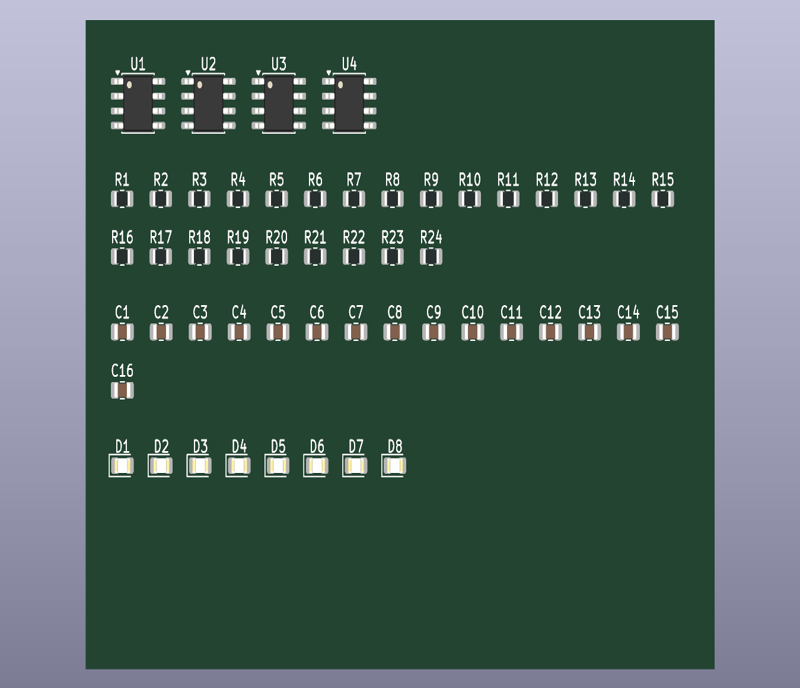

# KiCad footprint sorter (Python)

**"Update PCB from Schematic" dumped all your footprints in one heap?** This script sorts them into a clean grid in under a second: grouped by type (U, Q, J, R, C, L, D…), in **natural order** (R1, R2 … R10, not R1, R10, R11, R2), each one placed by its real size so nothing overlaps.

| Before: 52 parts in a heap, **618 DRC errors** | After `sort_footprints.py`: **0 DRC errors** |
|---|---|
|  |  |

📖 **Footprint scripting tutorials**: [scriptedpcb.com/en/footprints](https://scriptedpcb.com/en/footprints/)

## Usage

Run it with the **Python bundled with KiCad**, on a board that is **not routed yet** (moving footprints doesn't move tracks):

```bash
# Windows
"C:\Program Files\KiCad\10.0\bin\python.exe" sort_footprints.py my_board.kicad_pcb
# -> my_board_sorted.kicad_pcb
```

Close the board in KiCad first, then open the `_sorted` file (or overwrite the original with `--out`).

| Option | Effect |
|---|---|
| `--out FILE` | Output board (default `<input>_sorted.kicad_pcb`) |
| `--origin X,Y` | Top-left corner of the grid, in mm (default: inside the board outline) |
| `--width MM` | Maximum row width (default: board outline width) |
| `--gap MM`, `--row-gap MM` | Spacing between parts and between rows (default 1.5 mm) |
| `--margin MM` | Margin inside the board outline (default 3 mm) |
| `--keep-rotation` | Keep each footprint's rotation (default: reset to 0°) |

**Locked footprints stay exactly where they are** (connectors, mounting holes…): the grid flows around them.

## How it works

The one detail that makes the result readable is the natural sort key:

```python
def split_ref(ref):
    """'R10' -> ('R', 10)"""
    prefix, num = re.match(r"([A-Za-z_]+)(\d*)", ref).groups()
    return prefix.upper(), int(num) if num else 10 ** 9

for fp in sorted(members, key=lambda f: split_ref(f.GetReference())):
    ...  # place it at the next free slot, using its bounding box (texts included)
```

Sorting the plain strings would give `R1, R10, R11, R2…`; sorting on `(prefix, int(number))` gives `R1, R2 … R10`.

## Requirements

KiCad 8, 9 or 10 — tested on Windows with KiCad 8.0, 9.0 and 10.0.6, including a locked footprint in the middle of the heap (0 DRC errors after sorting on each).

Getting `No module named 'pcbnew'`? See [this troubleshooting guide](https://scriptedpcb.com/en/pcbnew/fix-no-module-named-pcbnew/).

## More KiCad Python scripts

- [kicad-pcb-ruler](https://github.com/leZfromFr/kicad-pcb-ruler) — a real 15 cm PCB ruler, drawn by Python
- [kicad-qr-code-pcb](https://github.com/leZfromFr/kicad-qr-code-pcb) — scannable QR codes on a PCB
- [kicad-python-scripts](https://github.com/leZfromFr/kicad-python-scripts) — LED ring, via stitching, copper zones, PCB coil, length matching
- Tutorials: **[scriptedpcb.com](https://scriptedpcb.com/en/)**

## License

MIT
